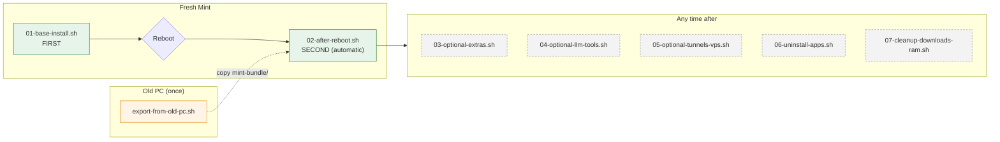
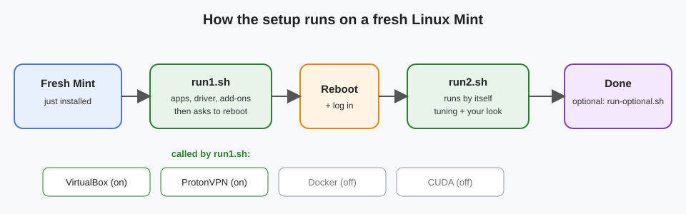
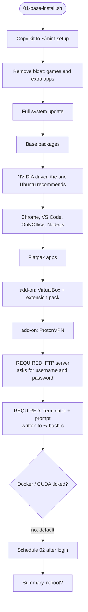
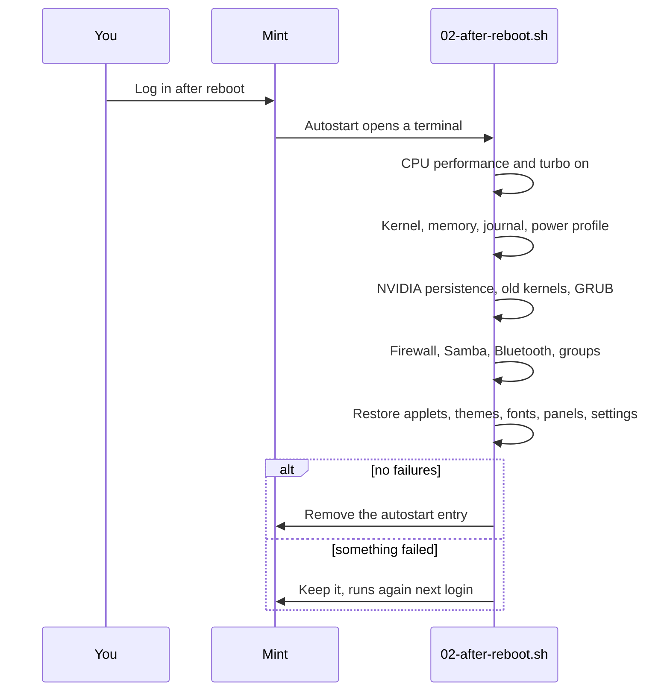
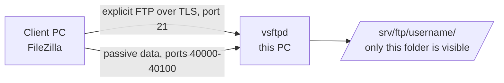
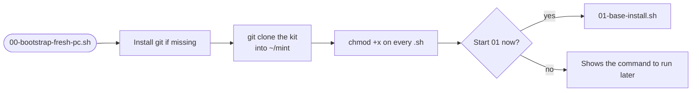
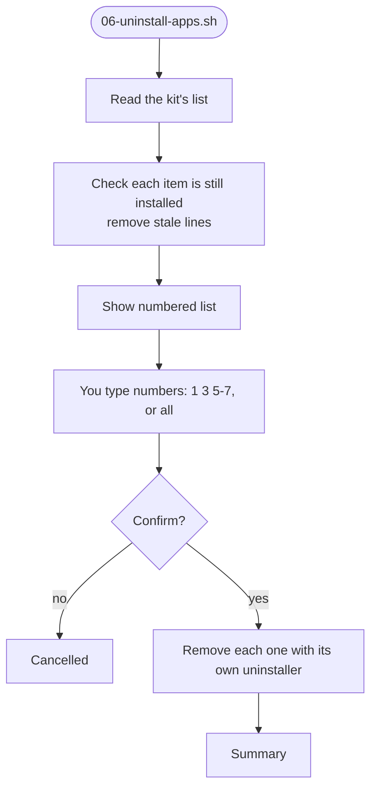
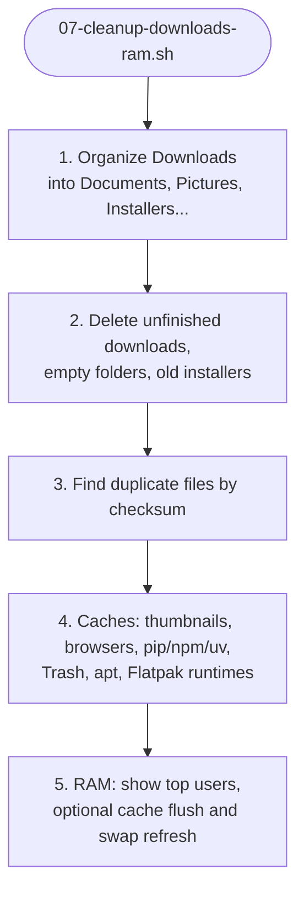

# Linux Mint Setup Kit

A set of scripts that turns a **fresh Linux Mint 22.x** install into your
machine: your apps, GPU driver, developer tools, VPN, and your exact Cinnamon
look. It also includes tools to remove what it installed and to keep the PC tidy.

Built from a read-only inventory of **your** PC (Xeon E5-2680 v4, RTX 3060,
Mint 22.3, Cinnamon 6.6). Nothing changes on a system until you run a script.

---

## 1. Which file to run, and when

**The file names start with a number. Run them in number order.**

| Order | File | Required? | When | What it does |
|:-----:|------|-----------|------|--------------|
| – | `export-from-old-pc.sh` | Only on your **old** PC | Once, before the fresh install | Saves your look and settings into `mint-bundle/` |
| **00** | **`00-bootstrap-fresh-pc.sh`** | **Yes** | **Before 01**, on the fresh install | Installs git, downloads the kit from GitHub into `~/mint`, makes all scripts executable, then offers to start 01 |
| **01** | **`01-base-install.sh`** | **Yes** | **First**, on the fresh install | Removes bloat, updates, installs apps, driver, add-ons, the FTP server and the terminal prompt. Then asks to reboot. |
| **02** | **`02-after-reboot.sh`** | **Yes** | **Second**, after the restart | Starts **by itself** after you log in. Tunes the PC and restores your desktop. |
| 03 | `03-optional-extras.sh` | Optional | Any time | Personal extras, each asks yes or no (browser wipe, work launcher, SVN...) |
| 04 | `04-optional-llm-tools.sh` | Optional | Any time | Web-dev and local-LLM tools: install or remove, choose from a menu |
| 05 | `05-optional-tunnels-vps.sh` | Optional | Any time | Cloudflare Tunnel, ngrok, and an SSH key for a VPS: install or remove |
| 06 | `06-uninstall-apps.sh` | Optional | Any time | Lists what the kit installed, you pick which to remove |
| 07 | `07-cleanup-downloads-ram.sh` | Optional | Any time | Organizes Downloads, clears safe caches, checks RAM |
| 08 | `08-optional-clean-unused-items.sh` | Optional | Any time | Finds unused applets, extensions, desklets, themes, icons and fonts. Moves your choice to a quarantine folder (nothing is deleted). |

The `core/` scripts are **required**: 01 always runs them. The `optional/` scripts are add-ons that 01 may call, and you can also run them yourself. The `tools/` scripts are helpers you run when needed.





### Quick start

```bash
# On the OLD PC (already done, the bundle is in mint-bundle/)
bash export-from-old-pc.sh

# On the FRESH PC, get the kit from GitHub and make scripts executable:
bash 00-bootstrap-fresh-pc.sh   # then answer y to start 01 (or run it yourself)

# On the FRESH PC: copy the whole mint-setup/ folder (with mint-bundle/), then:
cd mint-setup
bash 01-base-install.sh      # answer the reboot question with y
# ... PC reboots, you log in, 02-after-reboot.sh opens by itself ...
```

> Run every script with `bash`, **not** with `sudo`. Each script asks for your
> password when it needs it.

---

## 2. Folder layout

```
mint-setup/
├── README.md                    <- this file
├── 00-bootstrap-fresh-pc.sh      <- RUN FIRST on a fresh PC (git + download the kit)
├── export-from-old-pc.sh     <- run on the OLD PC
├── 01-base-install.sh           <- RUN FIRST
├── 02-after-reboot.sh           <- RUN SECOND (automatic after login)
├── 03-optional-extras.sh        <- optional personal extras
├── 04-optional-llm-tools.sh     <- optional: web dev + LLM tools (menu)
├── 05-optional-tunnels-vps.sh   <- optional: Cloudflare / ngrok / VPS key (menu)
├── 06-uninstall-apps.sh         <- optional: remove what the kit installed (menu)
├── 07-cleanup-downloads-ram.sh  <- optional: tidy Downloads, caches, RAM
├── 08-optional-clean-unused-items.sh <- optional: unused applets, themes, icons, fonts (quarantine)
├── common.sh                    <- shared helpers (do not run directly)
├── mint-bundle/                 <- your saved look (from 00)
├── optional/                    <- add-ons, called by 01 or run directly
│   ├── docker.sh                   install / status / purge Docker
│   ├── cuda.sh                     install / status / purge CUDA toolkit
│   ├── virtualbox.sh               install / status / purge VirtualBox + extension pack
│   └── vpn.sh                      install / status / purge ProtonVPN (free GUI)
├── core/                        <- REQUIRED, always run by 01
│   ├── ftp.sh                      FTP server (encrypted, vsftpd), with user setup
│   ├── terminal.sh                 Terminator + custom prompt (in ~/.bashrc, between markers)
│   └── terminatorUI.txt            the prompt code used by terminal.sh
├── tools/
│   └── inventory.sh             <- read-only report of a PC (what's installed, settings)
├── docs/                        <- pictures used in this README
└── archive/                     <- old versions, not used
```

Every installer script has the same three actions:

```bash
bash optional/docker.sh install
bash optional/docker.sh status
bash optional/docker.sh purge
```

---

## 3. Script details

### Export from the old PC: `export-from-old-pc.sh`

Reads your settings and copies them into `mint-bundle/`. It only **reads**.
Saves: desktop settings (dconf), applets, extensions, themes, icons, fonts,
autostart entries, default apps, and package lists.

### 01: base install (run first)



- **Removes:** games, Firefox (apt version, the Flatpak stays), Thunderbird,
  Chromium, Pidgin, Hexchat, GIMP, some Mint utilities and media apps.
- **Keeps:** Timeshift and PipeWire (both in use on your PC).
- **FTP server is required**: it always runs (`core/ftp.sh`), asks for a username and password, and opens the firewall.
- **Terminal prompt is required**: it always runs (`core/terminal.sh`), installs Terminator and the powerline fonts, and adds your prompt to `~/.bashrc`.
- **LM Studio** is in the Flatpak list, so a fresh install gets it. The menu in 04 shows it as installed.
- **Docker and CUDA are off** by default (`INSTALL_DOCKER=0`, `INSTALL_CUDA=0`).
- **Records** each package and app it installs in a list (see 06).

### 02: after reboot (run second, automatic)



| Area | What it does | Why |
|------|--------------|-----|
| CPU | Performance governor and **turbo on** at every boot | Turbo is **off** on your PC now |
| Power profile | `tuned` with `throughput-performance` | Your config had it, but it wasn't running |
| Kernel tuning | Memory and network settings from the old scripts | Responsiveness |
| Journal | Caps system logs at 200 MB | They used 449 MB |
| NVIDIA | `nvidia-persistenced` | Keeps the GPU ready |
| Old kernels | Removes unused kernels | Seven were installed |
| Firewall | `ufw`: deny incoming, allow outgoing, allow Samba | Safer default |
| Desktop | Applets, extensions, themes, icons, fonts, panels, shortcuts | Your exact look |

After 02, log out and back in (or Alt+F2, type `r`) to see the full look.

### 03: optional extras

Each item asks first. The default is **no**.

| # | Item | Risk |
|---|------|------|
| 1 | Wipe old Firefox/Chromium profiles | **Destroys** logins and bookmarks (you type `yes`) |
| 2 | Open your personal login tabs | None |
| 3 | Work launcher (VS Code, Chrome, Sticky, `Worksnaps/bin/run.sh`) | Needs those files |
| 4 | SaarathyGUI SVN checkout | Password typed at the prompt, never saved |
| 5 | Full dconf restore from the bundle | **Overwrites all** desktop settings (you type `yes`) |
| 6 | Open Cinnamon's startup-programs window | None |
| 7 | Remove Mint extras (`mintbackup`, `gucharmap`, `simple-scan`, `mintdrivers`, `mintlocale`) | `mintdrivers` and `mintlocale` can break driver and language tools |

### 04: web dev and LLM tools (optional menu)

Run `bash 04-optional-llm-tools.sh`. You see a list with status, and you type
`i 1 3` to install items 1 and 3, `r 2` to remove item 2, or `q` to quit.

| # | Item | What it is | How it's removed |
|---|------|------------|------------------|
| 1 | **LM Studio** | Desktop app to download and chat with local LLMs. Also serves an API. Installed from Flathub. | Flatpak uninstall. Asks before deleting models in `~/.lmstudio`. |
| 2 | **uv** | Very fast Python package and virtualenv manager | Deletes the binary |
| 3 | **nvtop** | Live GPU monitor for your RTX 3060 | Uninstalls the package |
| 4 | **Web dev CLI tools** | `mkcert` (local HTTPS certificates), `jq`, `httpie` | Uninstalls the packages |
| 5 | **pnpm** | Fast package manager for JavaScript projects | `npm uninstall -g` |
| 6 | **Bun** | Fast JavaScript runtime and bundler | Deletes `~/.bun` |
| 7 | **Postman + DBeaver** | API testing and database GUI (Flathub) | Flatpak uninstall |
| 8 | **Open WebUI** | Chat UI for local models at `localhost:3000`. Needs Docker. | Removes the container, asks about the image |

Command-line use: `bash 04-optional-llm-tools.sh install lmstudio`, or `remove lmstudio`.

### 05: tunnels and VPS (optional menu)


No open ports on your router are needed. The tunnel connects **out** to the provider.

| # | Item | What it does | Setup |
|---|------|--------------|-------|
| 1 | **Cloudflare Tunnel** (`cloudflared`) | Public address for a local site, free | Installs from Cloudflare's apt repository. Test: `cloudflared tunnel --url http://localhost:3000` |
| 2 | **ngrok** | Quick public URL for a local server | Installs from ngrok's repository. Asks for your authtoken (typed hidden). Test: `ngrok http 3000` |
| 3 | **VPS SSH key** | Creates `~/.ssh/id_ed25519_vps` for passwordless login to a VPS | Prints the copy command for your server |

> You mentioned "setup VPS". This item only creates the SSH key and the
> tunnel tools. If you meant **renting and setting up a server** (for example a
> DigitalOcean or Hetzner VPS with Nginx), tell me the provider and the OS on it.

### FTP server: `core/ftp.sh` (required, installed by 01)

Lets other PCs and phones reach files in `/srv/ftp/<username>` over FTP.
Installs **vsftpd** with encrypted logins (FTPS).



| Step | What happens |
|------|--------------|
| Install | vsftpd installed, config written, self-signed certificate created |
| Users | You create a username and password. Only listed users can log in. Each user is locked in their folder. |
| Firewall | Port 21 and passive ports 40000-40100 opened in ufw |
| Remove | `purge` removes the server, firewall rules and certificate. It asks before deleting any user's files. |

Connecting from another PC (FileZilla):

- Host: this PC's address, from `hostname -I`
- Port: `21`
- Encryption: **Require explicit FTP over TLS**
- Accept the self-signed certificate the first time

Plain FTP (no encryption) is switched off by default because it sends
passwords in readable form. Set `FTP_TLS=0` in the file only on a trusted local network.

Check it any time: `bash core/ftp.sh status`

### 00: bootstrap (run first on a fresh PC)

The first script on a fresh PC. It downloads the kit, so it is the only file you need to copy by hand (or fetch with the one-line `curl` command at the top of the file).



If `~/mint` already exists as a clone, it is updated with `git pull`. If it exists but is not a clone, the script stops and asks you to move it.

### 08: unused desktop items (optional)

Finds items you don't use and moves the ones you pick to a quarantine folder. Nothing is deleted.

| Type | Counts as unused when |
|---|---|
| Applet | Not placed on any panel |
| Extension, desklet | Not enabled |
| Theme, icon | Not the one Cinnamon uses (the `default` cursor folder is kept) |
| Font | Its family is not used by any setting or any installed applet, extension or desklet. Exact duplicate files are listed too. |

```bash
bash 08-optional-clean-unused-items.sh            # this PC
bash 08-optional-clean-unused-items.sh --bundle   # mint-bundle/ (before the export)
```

The moves are logged in `moved.tsv` inside the quarantine folder. To put an item back, use `mv` with the two paths from that file. Fonts are the main case: the check is a family-name match, so a font used by an app outside Cinnamon (for example a website or a game) can show as unused. Look at the list before you choose.

### Terminal and prompt: `core/terminal.sh` (required, installed by 01)

Installs **Terminator** and the powerline fonts, then adds your custom prompt
to `~/.bashrc`. The prompt shows user, host and a shortened path, for example
`…/FreshSystem/Scripts`.

- The prompt code is in `core/terminatorUI.txt`. It is written between two marker lines in `~/.bashrc`.
- Running install again does not add it twice.
- `bash core/terminal.sh purge` removes the block and keeps a backup of `.bashrc`.
- Open a new terminal window after install to see the prompt.

### 06: uninstaller (choose what to remove)

The kit keeps a list of what **it** installed: apt packages, Flatpak apps, npm
tools, add-ons and tools. It does **not** list packages pulled in as dependencies.
The NVIDIA driver is never listed.



| Kind | How it is removed |
|------|-------------------|
| apt | `apt-get purge` of that package only |
| flatpak | `flatpak uninstall` |
| npm | `npm uninstall -g` |
| addon | the add-on's own `purge` (Docker, CUDA, VirtualBox, VPN) |
| tool | the matching menu script's `remove` (04 or 05) |

Removal does **not** run `autoremove` for you. At the end the script suggests
`sudo apt-get autoremove` if you want to clean leftover dependencies.

Where the list lives: `~/.local/state/mint-setup/installed.tsv`. You can read it
with `cat`. Don't edit it by hand.

### 07: Downloads, caches and RAM



Every action shows what it will do and asks first. Things it never touches:
your `Documents`, `Pictures` contents, your browser profiles, and your VMs.

RAM note: Linux already uses spare RAM for caches and gives it back when apps
need it. Closing apps you don't use gains more than the flush does.

---

## 4. Checking the results

```bash
bash optional/docker.sh status
bash optional/cuda.sh status
bash optional/virtualbox.sh status
bash optional/vpn.sh status
bash 04-optional-llm-tools.sh status
bash 05-optional-tunnels-vps.sh status
bash core/ftp.sh status
bash core/terminal.sh status
cat /sys/devices/system/cpu/intel_pstate/no_turbo    # 0 = turbo ON
nvidia-smi                                            # GPU and driver
```

Logs for every run are in `~/mint-setup-logs/`:

```bash
grep -h "FAILED" ~/mint-setup-logs/*.log
```

---

## 5. Undo

| Want to remove | Use |
|----------------|-----|
| Anything the kit installed | `bash 06-uninstall-apps.sh` (pick numbers) |
| Docker | `bash optional/docker.sh purge` |
| CUDA toolkit (keeps your driver) | `bash optional/cuda.sh purge` |
| VirtualBox (keeps your VMs) | `bash optional/virtualbox.sh purge` |
| ProtonVPN | `bash optional/vpn.sh purge` |
| FTP server | `bash core/ftp.sh purge` (asks before deleting user files) |
| Terminal prompt | `bash core/terminal.sh purge` (keeps a backup of `.bashrc`) |
| LM Studio, uv, Bun, pnpm, Open WebUI | `bash 04-optional-llm-tools.sh remove <id>` |
| Cloudflare, ngrok, VPS key | `bash 05-optional-tunnels-vps.sh remove <id>` |
| Turbo and performance service | `sudo systemctl disable --now mint-cpu-performance.service` |
| Browser data after a wipe | Not recoverable. Back up first. |

---

## 6. Troubleshooting

| Problem | Likely cause | Fix |
|---------|--------------|-----|
| "Do not run this with sudo" | You used `sudo bash ...` | Run `bash <script>` |
| 02 didn't start after login | Autostart entry missing, or `~/mint-setup` not there | `bash ~/mint-setup/02-after-reboot.sh` |
| VirtualBox: "VT-x is in use by another hypervisor" | KVM still loaded | Reboot after install |
| VirtualBox module won't load after a kernel update | DKMS build failed for the new kernel | `sudo dpkg-reconfigure virtualbox-dkms`, then reboot |
| Extension pack missing | Not in Ubuntu's apt repository on this system | Use the manual command printed by `optional/virtualbox.sh install` |
| ProtonVPN download fails | Release-package address changed | Check [Proton's guide](https://protonvpn.com/support/linux-vpn-debian-ubuntu) and update `RELEASE_DEB_URL` in `optional/vpn.sh` |
| ProtonVPN won't open on Cinnamon | Proton officially supports GNOME only | Try Windscribe (free GUI), or tell me |
| `docker` needs sudo | You haven't logged out and back in | Log out and back in |
| Open WebUI won't start | Docker isn't installed | `bash optional/docker.sh install`, then retry in 04 |
| FTP client can't connect from another PC | Firewall or router port forwarding | Check `bash core/ftp.sh status`. Same network: allow port 21 and 40000-40100. Internet: forward those ports on your router. |
| FTP client refuses to connect with TLS | Client set to plain FTP | In FileZilla choose **Require explicit FTP over TLS** |
| FTP certificate warning | The certificate is self-signed | Accept it once. It is expected. |
| No prompt in a new terminal | `~/.bashrc` block missing | `bash core/terminal.sh status`, then `bash core/terminal.sh install` |
| Prompt shows boxes or odd symbols | Powerline font not in use | Set Terminator's font to a Powerline or Nerd Font |
| `06` shows nothing | The kit hasn't recorded anything yet | Run 01 first, or the items were already removed |
| "No mint-bundle folder" in 02 | Bundle not copied to the new PC | Copy `mint-bundle/` into the `mint-setup/` folder |
| A step shows FAILED | Missing package or network | Read the log in `~/mint-setup-logs/`, fix it, run that script again |

Every script is safe to run again. Each step checks what is already installed.

---

## 7. Glossary

| Term | Plain meaning |
|------|---------------|
| apt | Ubuntu and Mint's package manager |
| Flatpak | Apps that run in their own sandbox (from Flathub) |
| Driver (NVIDIA) | Software that lets Linux use the graphics card |
| CUDA toolkit | Developer tools for building GPU programs (optional) |
| LLM | Large language model, the AI that powers chatbots |
| LM Studio | Desktop app that downloads and runs LLMs on your PC |
| dconf | Where the desktop keeps its settings |
| Tunnel | A secure outgoing connection that gives a local server a public address |
| VPS | A rented Linux server on the internet |
| SSH key | A pair of files that log you in to a server without a password |
| tuned | Service that switches between performance and power-saving profiles |
| Governor | CPU setting that controls how fast the CPU clocks up |
| KVM | Built-in Linux virtualization. Conflicts with VirtualBox. |
| DKMS | Rebuilds kernel modules (like VirtualBox's) after a kernel update |
| ufw | Simple firewall |
| initramfs | Boot file that must be rebuilt after some module changes |
| FTP / FTPS | File transfer over the network. FTPS adds encryption (TLS). |
| TLS | The encryption that protects passwords and files on the network |
| Self-signed certificate | An encryption certificate made on your own PC. Works, but clients show a one-time warning. |
| Terminator | A terminal app for Linux |
| Powerline font | A font with the arrow and separator symbols used by fancy prompts |
| PROMPT_COMMAND | A bash setting that runs a function before each prompt. The custom prompt uses it. |

---

## 8. Your PC (from the inventory)

| Area | Finding | What the kit does |
|------|---------|-------------------|
| CPU | Xeon E5-2680 v4, 14 cores / 28 threads, turbo off | Turns turbo on (02) |
| Memory | 31 GB RAM, 9.5 GB swap, swappiness 10 | Keeps it |
| GPU | RTX 3060 on NVIDIA driver 595 | Installs the recommended driver (01), persistence (02) |
| Storage | NVMe system and home drives, SSD data drive, three HDDs | Keeps `fstrim` on |
| Audio | PipeWire with PulseAudio emulation | Keeps PipeWire |
| Logs | 449 MB journal | Capped at 200 MB (02) |
| Kernels | Seven installed | Removes unused ones (02) |
| Desktop | Cinnamon 6.6, Mint-L-Dark-Grey, Mint-Y-Grey icons | Restores from the bundle (02) |
| Applets | 7 applets, 4 extensions | Restores from the bundle (02) |

Full raw inventory: `~/mint-inventory/2026-11-01_0003/inventory.log`.

---

## Archive

`archive/` contains earlier versions, kept for reference only and not used:

- `README-v1.md`: the first README
- `common-v1.sh`: the first shared helpers
- `run1-old.sh`: the base install before add-ons were split out
- `04-optional-llm-tools-v1.sh`: the LLM menu before LM Studio replaced Ollama
- `mint-setup-master.sh`: the first merged setup script
