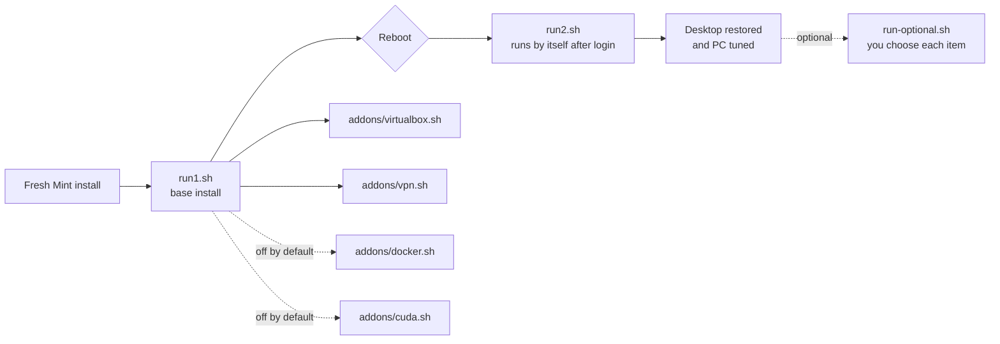
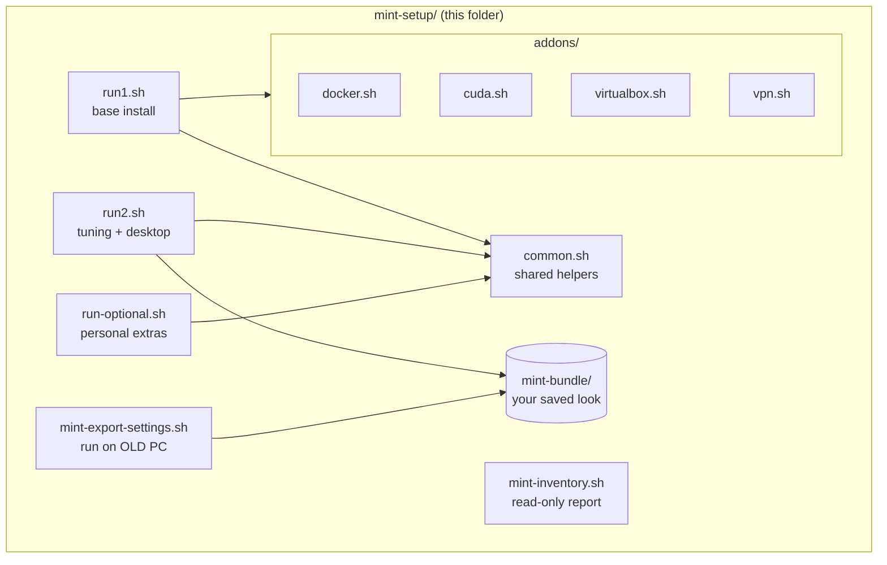
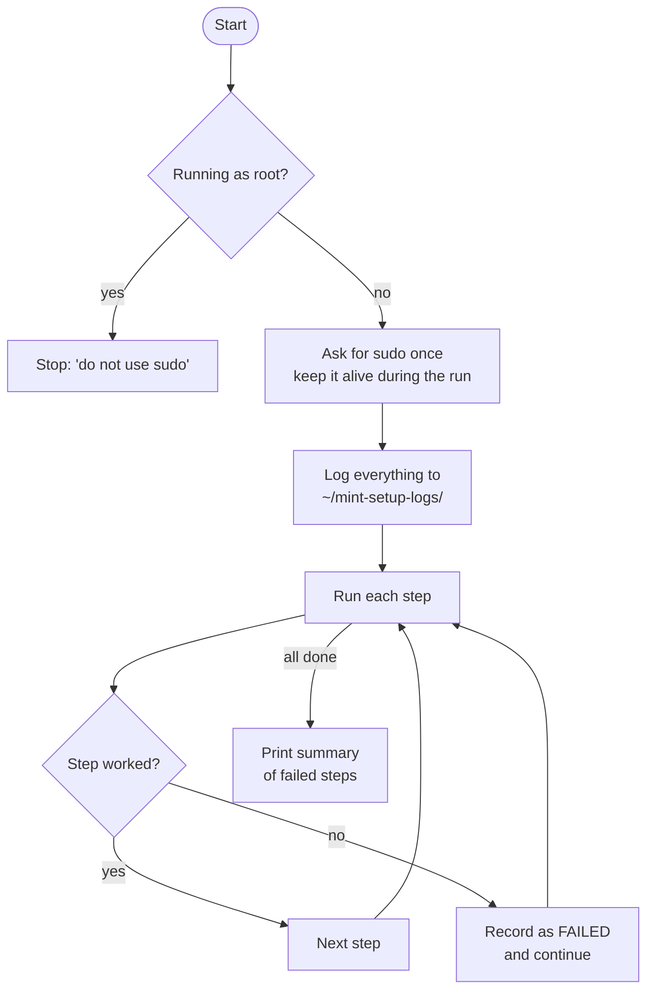
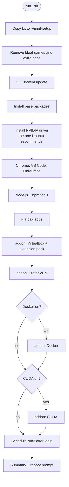
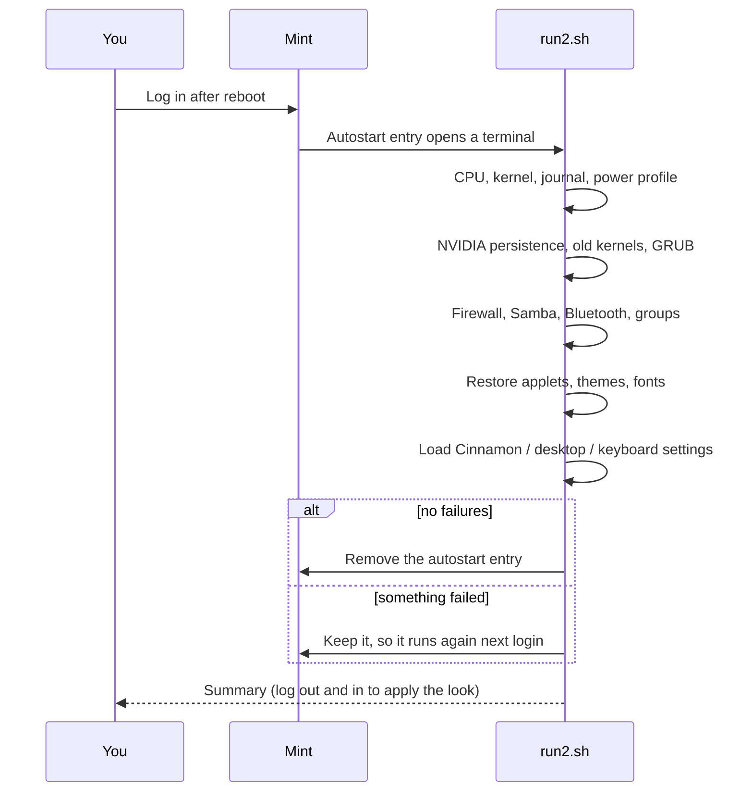
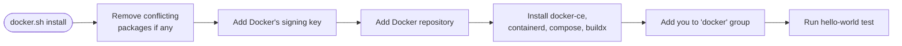
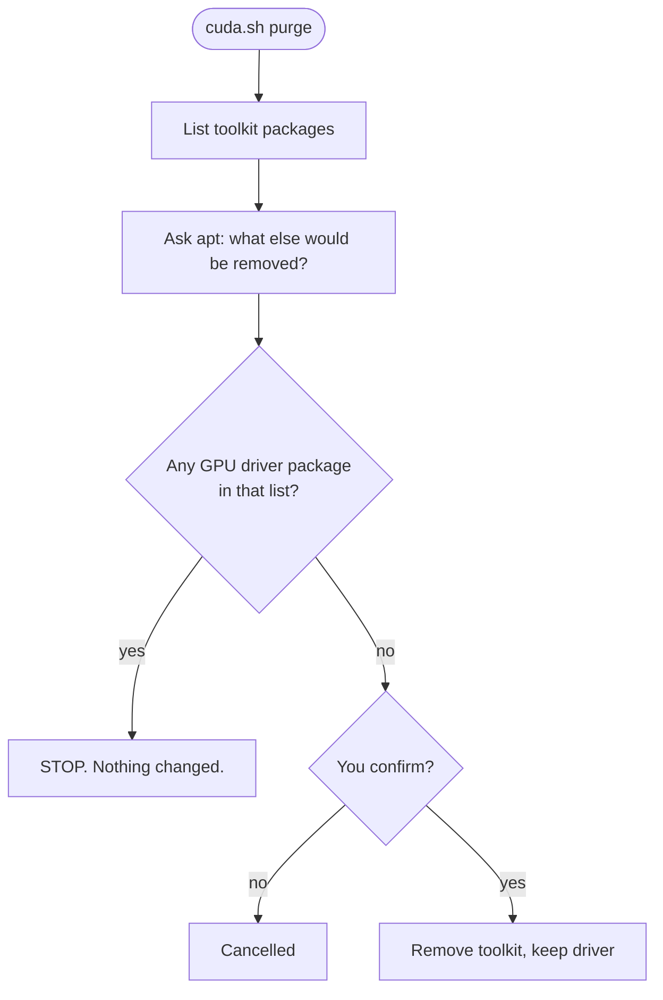
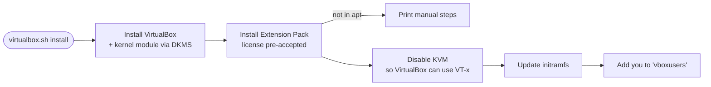

# Linux Mint Setup Kit

This kit sets up a **freshly installed Linux Mint 22.x** PC to match your
personal setup: your apps, your GPU driver, your VirtualBox, a free VPN,
and your exact Cinnamon look (theme, applets, panels, fonts).

It was built from a read-only inventory of **your** PC (Xeon E5-2680 v4,
RTX 3060, Mint 22.3, Cinnamon 6.6). Nothing is installed until you run it.

---

## Contents

1. [Quick start](#1-quick-start)
2. [How it works (big picture)](#2-how-it-works-big-picture)
3. [Folder layout](#3-folder-layout)
4. [Step by step](#4-step-by-step)
5. [Add-ons: Docker, CUDA, VirtualBox, VPN](#5-add-ons-docker-cuda-virtualbox-vpn)
6. [Settings reference](#6-settings-reference)
7. [Logs, checking results, and undo](#7-logs-checking-results-and-undo)
8. [Troubleshooting](#8-troubleshooting)
9. [Glossary](#9-glossary)
10. [What your PC looked like (inventory summary)](#10-what-your-pc-looked-like-inventory-summary)

---

## 1. Quick start

> Run each script with `bash`, **not** with `sudo`. The scripts ask for your
> password when they need it.

| # | Where | Command | What happens |
|---|-------|---------|--------------|
| 1 | Current PC (done) | `bash mint-export-settings.sh` | Saves your look, applets, fonts into `mint-bundle/` |
| 2 | Fresh install | Copy the whole `mint-setup/` folder (with `mint-bundle/`) to the PC | Brings the kit over |
| 3 | Fresh install | `bash run1.sh` | Installs apps, driver and add-ons, then offers a reboot |
| 4 | After reboot | Log in. `run2.sh` opens by itself | Tunes the PC and restores your desktop |
| 5 | Optional | `bash run-optional.sh` | Asks yes/no for personal extras (default is no) |


---

## 2. How it works (big picture)



### What each file is responsible for



### Every script uses the same safe pattern



**Why this matters:** one failed step (for example, a package that no longer
exists) does not stop the rest. You get a clear list at the end.

---

## 3. Folder layout

```
mint-setup/
├── README.md                 <- this file
├── run1.sh                   <- STEP 1: base install (run first)
├── run2.sh                   <- STEP 2: tuning + your desktop (automatic after login)
├── run-optional.sh           <- STEP 3: personal extras, each asks first
├── common.sh                 <- shared helper functions (do not run directly)
├── mint-export-settings.sh   <- run on your OLD PC to save your look
├── mint-inventory.sh         <- read-only report of a PC (what's installed, settings)
├── mint-bundle/              <- your saved look (created by the export script)
│   ├── dconf/                   desktop settings (cinnamon.ini, nemo.ini, ...)
│   ├── cinnamon/                applets, extensions, desklets
│   ├── themes/ icons/ fonts/    looks and fonts
│   ├── config/                  autostart, GTK bookmarks, default apps
│   └── lists/                   package lists (for reference)
├── addons/
│   ├── docker.sh             <- install / status / purge Docker
│   ├── cuda.sh               <- install / status / purge CUDA toolkit
│   ├── virtualbox.sh         <- install / status / purge VirtualBox + extension pack
│   └── vpn.sh                <- install / status / purge ProtonVPN (free GUI)
├── docs/
│   ├── flow.svg              <- overview picture
│   └── cuda-layers.svg       <- what CUDA is, layer by layer
└── archive/                  <- old versions, kept for reference (not used)
```

---

## 4. Step by step

### 4.1 `mint-export-settings.sh` (run on your current PC, already done)

Reads your settings and copies them into `mint-bundle/`. It only **reads**.

- Desktop settings (dconf): Cinnamon, GNOME desktop, media keys, Nemo, xreader
- Full dconf dump (used only if you choose it in `run-optional.sh`)
- Applets, extensions, desklets, themes, icons, fonts
- Autostart entries, GTK bookmarks, default apps (`mimeapps.list`)
- Lists of your apt, Flatpak and npm packages (for reference)

### 4.2 `run1.sh`: base install



What it **removes**: games (Aisleriot, Mines, Sudoku, Mahjongg and others),
Firefox (apt version, the Flatpak stays), Thunderbird, Chromium, Pidgin,
Hexchat, GIMP, some Mint utilities, and a few media apps. Your **Timeshift**
and **PipeWire** are kept.

What it **installs**: build tools, VLC, MPV, FFmpeg, Samba, Bluetooth tools,
`tuned`, `timeshift`, `xreader`, Remmina, GameMode, `nvidia-settings`, and more.
The full list is at the top of `run1.sh`.

### 4.3 Reboot, then `run2.sh` (automatic)

`run1.sh` creates a login entry (`~/.config/autostart/mint-setup-run2.desktop`).
When you log in, a terminal opens and runs `run2.sh`. When it finishes with no
failures, the entry removes itself.



What `run2.sh` does, in plain words:

| Area | What it does | Why |
|------|--------------|-----|
| **CPU** | Sets the `performance` governor and **turns turbo boost on** | Turbo is currently **off** on your PC |
| **Power profile** | Starts `tuned` with `throughput-performance` | Your config had it but it wasn't running |
| **Kernel tuning** | Applies the memory and network settings from the old scripts | Better responsiveness for big transfers |
| **Journal** | Caps system logs at 200 MB | They used 449 MB |
| **NVIDIA** | Starts `nvidia-persistenced` | Keeps the GPU ready, so the first app launch is faster |
| **Old kernels** | Removes unused kernels (the running one is kept) | You had seven kernels installed |
| **GRUB** | Hides the text-console cursor | Already set on your PC; this is a no-op there |
| **Firewall** | `ufw`: deny incoming, allow outgoing, allow Samba | Safer default |
| **Samba / Bluetooth** | Starts file sharing and Bluetooth | Your PC uses both |
| **Groups** | Adds you to `vboxusers` and `sambashare` | Needed for VirtualBox and Samba |
| **Desktop** | Copies applets, extensions, themes, icons, fonts, autostart and loads your Cinnamon settings | Your exact look |

### 4.4 `run-optional.sh`: personal extras (each defaults to **no**)

| # | Item | What it does | Risk |
|---|------|--------------|------|
| 1 | Wipe browser profiles | Deletes Firefox and Chromium profiles, logins, bookmarks | **Destroys data**. Asks you to type `yes`. |
| 2 | Personal login tabs | Opens your 7 saved websites in Chrome | None |
| 3 | Work launcher | Opens VS Code, Chrome, Sticky Notes and runs `Worksnaps/bin/run.sh` | Needs those files to exist |
| 4 | SaarathyGUI SVN checkout | Asks for username and password at the prompt, then downloads the project | Password is typed, never saved |
| 5 | Full dconf restore | Overwrites **all** desktop settings with your old PC's copy | **Overwrites everything**. Asks you to type `yes`. |
| 6 | Startup settings | Opens Cinnamon's startup-programs window | None |
| 7 | Remove Mint extras | Removes `mintbackup`, `gucharmap`, `simple-scan`, `mintdrivers`, `mintlocale` | `mintdrivers` / `mintlocale` can break driver and language tools |

---

## 5. Add-ons: Docker, CUDA, VirtualBox, VPN

Each add-on works **on its own** too. Each has three actions:

```
bash addons/<name>.sh install
bash addons/<name>.sh status
bash addons/<name>.sh purge
```

Default settings in `run1.sh`:

| Add-on | Default in `run1.sh` | Reason |
|--------|----------------------|--------|
| VirtualBox | **on** | You used it before (guest additions were installed) |
| ProtonVPN | **on** | You asked for a free GUI VPN |
| Docker | **off** | You don't use Docker |
| CUDA toolkit | **off** | You don't use it (see below) |

### 5.1 Docker: `addons/docker.sh`

Installs **Docker Engine** from Docker's official repository (`docker-ce`),
which is newer than Ubuntu's `docker.io`. It also installs Compose and Buildx.



| Command | What it does |
|---------|--------------|
| `bash addons/docker.sh install` | Installs and tests Docker |
| `bash addons/docker.sh status` | Shows version, service state and group membership |
| `bash addons/docker.sh purge` | Removes Docker, **all images, containers, volumes**, and the repository. Asks first. |

After install, log out and back in once so the `docker` group works without
`sudo`.

### 5.2 CUDA toolkit: `addons/cuda.sh`

**What is CUDA?** CUDA is NVIDIA's platform for running general-purpose code on
the GPU. There are two pieces, and it helps to know which one is which:


- **The driver** (you already have it, version 595): runs everything that
  uses the GPU, including games, the desktop, and apps that use CUDA at run
  time. **Keep it.**
- **The toolkit** (`nvidia-cuda-toolkit`): compilers (`nvcc`) and developer
  tools, needed only to **build** CUDA programs. **Optional.**

Apps like LM Studio normally bring their own GPU runtime, so they don't need
the toolkit. If an app ever says "CUDA toolkit not found" while building
something, install it with `addons/cuda.sh install`.

**Purge safety:** before removing anything, `cuda.sh` asks apt what it would
remove. If that list includes any driver package, it **stops and changes
nothing**.



### 5.3 VirtualBox: `addons/virtualbox.sh`

Installs VirtualBox from Ubuntu's repository (version 7.0.x for noble), the
**Extension Pack** (USB 2.0/3.0, RDP, disk encryption), and the guest additions ISO.



- **KVM note:** KVM and VirtualBox can't use the CPU's virtualization at the
  same time. The script disables KVM (`BLACKLIST_KVM=1`). Set it to `0` if you
  use KVM or QEMU.
- **Your VMs are safe:** `purge` never deletes `~/VirtualBox VMs`.
- **Newer VirtualBox:** Oracle's own repository has newer builds. The Ubuntu
  version is used here because it is simpler to keep updated through apt.
- **Kernel 7.0:** the VirtualBox kernel module is built for your kernel by DKMS.
  If it fails to build, see [Troubleshooting](#8-troubleshooting).

### 5.4 ProtonVPN (free): `addons/vpn.sh`

**ProtonVPN** has a free plan with a graphical app and no data cap. It needs a
free Proton account. This script installs the GUI app from Proton's own
repository.


- **Sign-in is manual.** The script can't log in for you.
- **Desktop:** Proton supports GNOME officially. It should run on Cinnamon,
  but this is **not guaranteed**. If the app won't start, let me know.
- **Alternative free GUI VPN:** Windscribe (free plan, also has a Linux app).
- **Checking the URL:** if the download fails, check Proton's
  [Debian/Ubuntu guide](https://protonvpn.com/support/linux-vpn-debian-ubuntu)
  for the current release-package address.

---

## 6. Settings reference

Settings are plain variables at the top of each script. `1` = yes, `0` = no.

| File | Setting | Default | Meaning |
|------|---------|---------|---------|
| `run1.sh` | `INSTALL_CHROME` | 1 | Google Chrome |
| `run1.sh` | `INSTALL_VSCODE` | 1 | VS Code |
| `run1.sh` | `INSTALL_ONLYOFFICE` | 1 | OnlyOffice |
| `run1.sh` | `INSTALL_NODE` | 1 | Node.js + npm globals |
| `run1.sh` | `INSTALL_FLATPAKS` | 1 | Flatpak apps (list in the file) |
| `run1.sh` | `INSTALL_VIRTUALBOX` | 1 | calls `addons/virtualbox.sh install` |
| `run1.sh` | `INSTALL_VPN` | 1 | calls `addons/vpn.sh install` |
| `run1.sh` | `INSTALL_DOCKER` | 0 | calls `addons/docker.sh install` |
| `run1.sh` | `INSTALL_CUDA` | 0 | calls `addons/cuda.sh install` |
| `run2.sh` | `ENABLE_CPU_PERFORMANCE` | 1 | Performance governor + turbo on at every boot |
| `run2.sh` | `TUNED_PROFILE` | throughput-performance | Power/throughput profile |
| `run2.sh` | `JOURNAL_MAX` | 200M | Maximum size of system logs |
| `run2.sh` | `CLEAN_OLD_KERNELS` | 1 | Remove unused old kernels |
| `run2.sh` | `ENABLE_GRUB_CURSOR_OFF` | 1 | Hide text-console cursor |
| `run2.sh` | `RESTORE_DESKTOP` | 1 | Restore your look from `mint-bundle/` |
| `run2.sh` | `BLUETOOTH_AUTO_ENABLE` | 0 | Power Bluetooth on at boot |
| `addons/virtualbox.sh` | `BLACKLIST_KVM` | 1 | Disable KVM for VirtualBox |

---

## 7. Logs, checking results, and undo

### Logs

Every run writes a log to `~/mint-setup-logs/`, named by script and time:

```
~/mint-setup-logs/run1-2026-11-01_0900.log
~/mint-setup-logs/run2-2026-11-01_1015.log
~/mint-setup-logs/virtualbox-install-2026-11-01_0930.log
```

Search for failures:

```bash
grep -h "FAILED" ~/mint-setup-logs/*.log
```

### Checking each part

```bash
bash ~/mint-setup/addons/docker.sh status
bash ~/mint-setup/addons/cuda.sh status
bash ~/mint-setup/addons/virtualbox.sh status
bash ~/mint-setup/addons/vpn.sh status
systemctl status tuned
cat /sys/devices/system/cpu/intel_pstate/no_turbo    # 0 means turbo is ON
nvidia-smi                                            # GPU and driver
```

### Undo

| Want to undo | Command |
|--------------|---------|
| Docker | `bash addons/docker.sh purge` |
| CUDA toolkit (keeps driver) | `bash addons/cuda.sh purge` |
| VirtualBox | `bash addons/virtualbox.sh purge` |
| ProtonVPN | `bash addons/vpn.sh purge` |
| Turbo / performance | `sudo systemctl disable --now mint-cpu-performance.service` |
| Personal browser data | Not recoverable once wiped. Back up first. |

---

## 8. Troubleshooting

| Problem | Likely cause | Fix |
|---------|--------------|-----|
| "Do not run this with sudo" | You used `sudo bash run1.sh` | Run `bash run1.sh` |
| run2 didn't start after login | Autostart entry missing, or the `~/mint-setup` folder not there | `bash ~/mint-setup/run2.sh` |
| VirtualBox "VT-x is in use by another hypervisor" | KVM still loaded | Reboot after install. Check `lsmod \| grep kvm` |
| VirtualBox module won't load after a kernel update | DKMS build failed for the new kernel | `sudo dpkg-reconfigure virtualbox-dkms`, then reboot |
| Extension pack not installed | Not in Ubuntu's apt repository | Use the manual command printed by `virtualbox.sh install` |
| Proton VPN download fails | Release URL changed | Check the [Proton guide](https://protonvpn.com/support/linux-vpn-debian-ubuntu) and update `RELEASE_DEB_URL` in `addons/vpn.sh` |
| Proton VPN window doesn't open | Cinnamon isn't officially supported by Proton | Try Windscribe, or tell me and I'll adjust |
| `docker` needs sudo | You haven't logged out and back in | Log out and back in |
| "No mint-bundle folder" in run2 | The bundle wasn't copied to the new PC | Copy `mint-bundle/` next to `run2.sh`, then run `bash run2.sh` |
| Desktop still old after run2 | Cinnamon hasn't reloaded | Log out and back in, or Alt+F2 then `r` |
| A step shows FAILED | Package missing or network issue | Read the log in `~/mint-setup-logs/`, fix, then run that script again |

Safe to run again: every step checks what is already installed, so running
`run1.sh` or `run2.sh` twice does not break anything.

---

## 9. Glossary

| Term | Plain meaning |
|------|---------------|
| **apt** | Ubuntu/Mint package manager (`apt install`, `apt purge`) |
| **Flatpak** | App packages that run in their own sandbox (from Flathub) |
| **Driver (NVIDIA)** | Software that lets Linux use the graphics card |
| **CUDA toolkit** | Developer tools for building GPU programs (optional) |
| **dconf** | Where Linux desktops keep settings (theme, panels, shortcuts) |
| **Cinnamon** | The desktop environment Mint uses |
| **Applet / extension** | Small add-ons for the Cinnamon panel or desktop |
| **tuned** | Service that switches the PC between performance and power-saving profiles |
| **Governor** | CPU setting that decides how fast the CPU clocks up |
| **Turbo boost** | Lets the CPU run faster than its base speed when needed |
| **KVM** | Built-in Linux virtualization; conflicts with VirtualBox |
| **DKMS** | Rebuilds kernel modules (like VirtualBox's) when the kernel updates |
| **ufw** | Simple firewall |
| **Samba** | Shares folders with Windows and other PCs |
| **initramfs** | Boot file that must be updated after some module changes |
| **Autostart entry** | A `.desktop` file that runs something at login |

---

## 10. What your PC looked like (inventory summary)

From `mint-inventory.sh` on this PC:

| Area | Finding | What the kit does |
|------|---------|-------------------|
| CPU | Xeon E5-2680 v4, 14 cores / 28 threads, **turbo off** | Turns turbo on (`run2.sh`) |
| Memory | 31 GB RAM, 9.5 GB swap, swappiness 10 | Keeps your settings |
| GPU | RTX 3060 on NVIDIA driver 595 | Installs the recommended driver; adds persistence |
| Storage | NVMe (system), SSD (data), three HDDs; `fstrim` already on | Keeps `fstrim` |
| Audio | PipeWire with PulseAudio emulation | Keeps PipeWire (not removed) |
| Logs | 449 MB journal | Caps at 200 MB |
| Kernels | Seven installed | Removes unused ones |
| Desktop | Cinnamon 6.6, Mint-L-Dark-Grey, Mint-Y-Grey icons, Bibata cursor | Restores from `mint-bundle/` |
| Applets | 7 applets, 4 extensions | Restores from `mint-bundle/` |
| Shortcuts | Defaults only | Restores media-key settings |
| Packages | About 1,900 manual apt packages, 14 Flatpaks | Installs the apps you use |

Full raw log: `~/mint-inventory/2026-11-01_0003/inventory.log`.

---

## Archive

`archive/` holds the earlier versions: `mint-setup-master.sh` (first merged
version) and `run1-old.sh` (before the VirtualBox, Docker, CUDA and VPN
add-ons were split out). They are kept for reference only and are not used.
